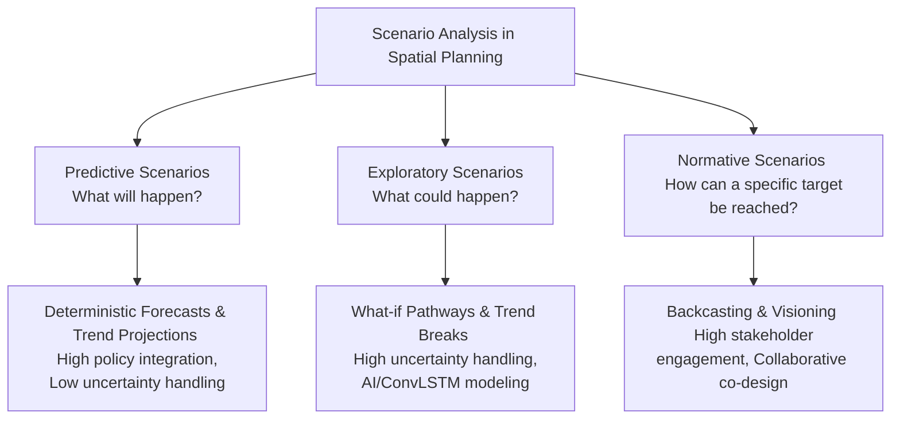

# Scenario Analysis Frameworks in Spatial Planning: A Literature Review (2015–2026)

## Executive Summary
This literature review examines peer-reviewed academic literature published from 2015 to 2026 regarding **scenario analysis frameworks in spatial planning**. Driven by deep uncertainty, climate change, rapid urbanization, and complex socio-ecological interactions, spatial planning has shifted away from deterministic, predictive forecasting toward dynamic, multi-scenario frameworks. 

Synthesizing recent methodological reviews, typologies (such as Börjeson et al. and Abou Jaoude et al., 2022), and epistemological perspectives (e.g., theories of truth in futures knowledge by Airikkala, 2026), this review categorizes scenario approaches into predictive, exploratory, and normative backcasting frameworks. It evaluates their institutional embedding, handling of uncertainty, stakeholder engagement mechanisms, and persistent literature gaps.

---

## 1. Introduction & Evolution of Scenario Thinking in Spatial Planning

Traditionally, spatial and urban planning relied on linear forecasting techniques—projecting historical population growth and economic trends forward to determine future land-use zoning and infrastructure requirements. However, in an era characterized by climate shocks, economic volatility, and socio-ecological transitions, such deterministic forecasts frequently fail.

Since the mid-2010s, scenario analysis has transitioned from corporate futures studies into a core methodological pillar of strategic spatial planning and urban design. Scenarios provide structured narratives or quantitative simulations of alternative future operating environments, enabling planners and policymakers to stress-test spatial policies against multiple plausible trajectories.

---

## 2. Typological Frameworks of Scenario Analysis

Scholarly literature consistently categorizes planning scenarios along foundational typologies (most notably Börjeson et al., integrated into recent spatial planning reviews by Abou Jaoude et al., 2022):

### A. Predictive Scenarios ("What will happen?")
* **Focus:** Extrapolating historical trends into the future under assumed continuity.
* **Role in Planning:** Highly institutionalized in traditional statutory zoning, transport modeling, and demographic forecasting. 
* **Limitation:** Performs poorly under structural breaks, abrupt climate events, and systemic shocks.

### B. Exploratory Scenarios ("What could happen?")
* **Focus:** Investigating multiple plausible futures driven by exogenous uncertainties (e.g., climate change severity, geopolitical shifts, technological disruption).
* **Role in Planning:** Used in city-regional land-use and transportation (LUT) planning to evaluate the robustness of spatial strategies across diverse operating environments. Recent advances incorporate advanced modeling techniques (e.g., Convolutional LSTM neural networks for multi-scenario land cover forecasting).

### C. Normative Scenarios ("How can a specific target be reached?")
* **Focus:** Starting from a desirable future vision (e.g., carbon-neutral cities, biodiversity net gain) and working backward (*backcasting*) to identify necessary policy interventions and spatial transformations.
* **Role in Planning:** Highly effective for participatory visioning, sustainability transitions, and collaborative local climate adaptation planning.

---

## 3. Epistemological Foundations: The "Theories of Truth" Perspective

A major theoretical advancement in recent spatial planning literature (Airikkala, 2026) introduces a *theories of truth* framework to evaluate futures knowledge in spatial scenario planning. This framework reconciles divergent methodological traditions by making three validity bases explicit:

1. **Correspondence:** Empirical fit and biophysical realism (tested against spatial GIS databases, hydrological models, and ecological carrying capacities).
2. **Coherence:** Narrative and internal consistency across multi-variable storylines (ensuring socio-economic and environmental assumptions do not contradict).
3. **Pragmatic Utility:** Actionability, stakeholder empowerment, and usability within real-world political and administrative decision-making arenas.

---

## 4. Institutional Embedding and Policy Uptake

Despite methodological proliferation, integrating scenario frameworks into statutory spatial planning faces chronic institutional barriers:
* **Statutory Rigidity vs. Fluid Scenarios:** Statutory land-use plans are legally binding, slow to amend, and anchored in regulatory certainty. In contrast, exploratory scenarios are fluid, probabilistic, and exploratory, creating friction in legal planning systems.
* **Cross-Sectoral Coordination:** Spatial scenario exercises often expose organizational silos between municipal zoning authorities, regional transport agencies, and national environmental ministries.

---

## 5. Major Debates & Recurring Challenges

1. **Quantification vs. Narrative Quality:** A persistent debate concerns the balance between rigorous quantitative simulation (GIS models, cellular automata, machine learning land-cover predictors) and qualitative, deliberative storytelling. Over-quantification risks false precision, whereas pure narratives often lack spatial explicitness.
2. **Democratic Legitimacy in Participatory Scenario Planning:** While normative and backcasting scenarios champion stakeholder engagement, critical planning scholarship warns that scenario workshops can be co-opted by powerful economic actors, masking political contestation behind participatory facade.

---

## 6. Literature Gaps & Emerging Research Frontiers

1. **Real-Time Dynamic Scenario Updating:** Most planning scenarios are static outputs generated during planning cycles. Research is needed on adaptive, real-time scenario frameworks linked to live sensor data and digital twins.
2. **Cross-Scale Scalar Friction:** Limited frameworks successfully bridge local municipal scenario design with macro-regional or transnational EU-level policy mandates.
3. **Evaluation of Long-Term Implementation Success:** Empirical post-occupancy evaluations examining whether spatial decisions derived from scenario planning actually delivered desired long-term resilience remain scarce.

---

## 7. Conclusion

Scenario analysis frameworks have evolved from corporate forecasting tools into sophisticated, multi-typology instruments of strategic spatial planning. By integrating predictive rigor, exploratory stress-testing, and normative backcasting—underpinned by explicit epistemological validity bases—spatial planners can better navigate deep uncertainty and steer sustainable regional transformations.

---
*Literature review completed: November 2026.*
