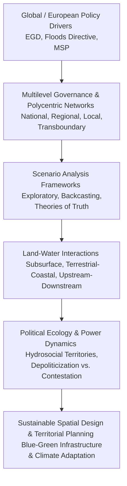

# Spatial Planning Scenario Analysis & Land-Water Governance in Europe: A Literature Review (2015–2026)

## Executive Summary
This literature review examines peer-reviewed academic research and major European project frameworks published from 2015 to 2026 concerning **spatial design and planning scenario analysis**, with a specific focus on **governance, land-water interactions, and stakeholder relations**. Driven by anthropogenic climate change, biodiversity loss, and systemic floods and droughts, European spatial planning has undergone a "spatial turn" in water management and a corresponding "territorial turn" in environmental policy. 

Synthesizing literature across political ecology, multi-level governance, socio-hydrology, and strategic foresight, this review identifies major debates (e.g., technocratic scenario modeling versus participatory contestation), recurring authors and networks (e.g., Boelens, Swyngedouw, Rauws, Bousema), and critical literature gaps. The findings provide a robust foundation for developing an integrated theoretical framework combining **scale, political ecology, governance, and land-water relations**.

---

## 1. Introduction & Contextual Evolution (2015–2026)

European spatial planning over the past decade has increasingly grappled with the convergence of terrestrial and aquatic management. Historically, water management and terrestrial spatial planning operated as siloed institutional domains—water engineers focused on hydrological flows and flood defense structures, while urban and regional planners focused on zoning, housing, and economic development. 

Since the mid-2010s, landmark European policy initiatives—such as the European Green Deal, the EU Floods Directive, Maritime Spatial Planning (MSP) Directives, and the EU Mission *"Restore our Ocean and Waters by 2030"*—have catalyzed a cross-sectoral shift. Scenario analysis has emerged as a core methodological instrument to explore alternative socio-ecological futures under deep uncertainty. However, applying scenario frameworks to land-water interactions reveals profound institutional friction, scalar mismatches, and power asymmetries.

---

## 2. Conceptual & Theoretical Frameworks

Scholarly literature published post-2015 converges around four primary theoretical pillars:

### A. Hydrosocial Territories and Political Ecology
Rooted in critical geography and political ecology, the concept of **hydrosocial territories**—pioneered and expanded by Boelens et al. (2016) and reviewed extensively in contemporary political ecology of water (Alba, 2025)—conceptualizes water and land not merely as biophysical resources, but as politically contested spatial configurations of people, institutions, technology, and ecological flows. Territorial politics manifests when diverse actors with divergent scalar interests clash over how water is governed.

### B. Ecological Rationality in Spatial Planning
Advocated by scholars seeking to re-found spatial planning under ecological imperatives (e.g., Maruani & Amit-Cohen; recent work on ecological rationality in spatial planning, 2020–2023), this framework challenges neoliberal growth paradigms. It asserts that spatial scenario frameworks must prioritize ecosystem integrity, carrying capacities, and blue-green infrastructure (GBI) networks over short-term economic optimization.

### C. Polycentricity and Adaptive Governance
Drawing on Ostromian institutional economics and adaptive management theory, European scholarship (e.g., Bousema et al., Rauws et al. in Dutch strategic spatial planning) investigates how polycentric governance systems and institutional rules (such as forum rule adaptation) handle interdependent land-water challenges across municipal, regional, and transnational boundaries.

### D. Theories of Truth in Spatial Scenario Planning
Addressing epistemological foundations, recent methodological literature (e.g., Hokkanen et al., 2026) introduces a *theories of truth perspective* to futures knowledge in strategic spatial planning. This framework integrates three validity bases:
1. **Correspondence:** Empirical fit with biophysical and hydrological data.
2. **Coherence:** Narrative consistency across socio-economic and environmental storylines.
3. **Pragmatic:** Actionability and usefulness in participatory policy arenas.

---

## 3. Governance & Multi-Scale Challenges in Land-Water Scenarios

The integration of land and water governance across European regions reveals significant scalar tensions:

* **Vertical and Horizontal Frontiers:** As identified in integrative water resources management (IWRM) scholarship, integration operates along three critical frontiers: the *vertical frontier* (subsurface groundwater vs. surface land use), the *horizontal frontier* (terrestrial-coastal land-sea interactions), and the *transboundary frontier* (upstream-downstream river basin planning, e.g., the Danube River Basin / EcoDaLLi project).
* **Institutional Mismatches:** ESPON COMPASS research and comparative European typologies demonstrate that planning systems vary widely in their capacity for public control. Statutory land-use plans are often legally binding at municipal scales, whereas water basin management plans (RBMPs) operate at hydrographic scales that rarely align with municipal boundaries.
* **Scenario Frameworks in Practice:** Major EU projects (e.g., *BlueGreen Governance*, *MSPACE*, *BINGO*) highlight that scenario planning bridges this gap only when co-created through iterative stakeholder engagement rather than imposed via top-down modeling.

---

## 4. Stakeholder Relations & Power Dynamics

A recurring debate in post-2015 literature centers on the tension between **participatory consensus-building** and **critical political ecology**.

* **Participatory Modeling and Co-Design:** Modern frameworks emphasize stakeholder co-development of scenarios (e.g., multi-criteria decision analysis of regional preferences, participatory backcasting). Engaging agricultural, industrial, municipal, and ecological stakeholders ensures social acceptance of climate-smart spatial plans.
* **The Danger of Depoliticization:** Critical political ecologists argue that technocratic scenario models and consensus-seeking participatory forums frequently mask underlying power asymmetries. When planning processes frame land-water management as neutral "technical optimization" or "win-win resilience," they often marginalize vulnerable communities, indigenous water rights, and non-commodity ecological values.
* **Forum Rule Adaptation:** Research on collaborative spatial planning forums shows that the rules governing stakeholder engagement are rarely static; their ongoing adaptation is heavily influenced by forum founders and existing institutional power structures (Bousema et al.).

---

## 5. Major Debates, Recurring Authors & Methodological Trends

### Major Debates
1. **Technocratic Modeling vs. Emancipatory Politics:** Whether scenario frameworks should serve as expert-driven predictive optimization tools or discursive platforms for social mobilization and environmental justice.
2. **Cross-Border Harmonization vs. Place-Based Specificity:** Balancing standardized European directives (e.g., EU Green Infrastructure strategy) with locally embedded, path-dependent planning traditions.

### Recurring Authors & Schools of Thought
* **Political Ecology & Hydrosocial Territories:** Rutgerd Boelens, Erik Swyngedouw, Alba (2025).
* **Strategic Spatial Planning & Governance (Europe/Netherlands):** Ward Rauws, Tim Busscher, Ingo Bousema, Wim Leendertse.
* **Spatial Planning & Climate Adaptation / Flood Risk:** Joost Zevenbergen, Matheus Van Vliet, and researchers in Alpine Space and Baltic Sea Region planning consortia.

---

## 6. Literature Gaps & Emerging Research Frontiers

1. **Explicit Integration of Political Ecology into Quantitative Scenario Models:** While biophysical models (hydrological, land-use change) are robust, they rarely integrate power relations, land tenure inequality, or hydrosocial conflicts dynamically within scenario algorithms.
2. **Cross-Realm Spillover Effects:** Limited empirical work examines how land-based densification and urban expansion systematically cascade into marine and coastal ecosystems (land-sea interaction gaps highlighted by the *BlueGreen Governance* initiative).
3. **Actionability of "Theories of Truth":** Translating abstract epistemological validity bases into operational guidelines for municipal planners facing urgent climate shocks.

---

## 7. Conclusion: Foundations for a Theoretical Framework

To support the development of a unified theoretical framework on **scale, political ecology, governance, and land-water relations**, future research and methodological design must synthesize:
* **Multiscalar Institutional Architecture:** Recognizing that governance must bridge nested polycentric tiers from local river reaches to transnational river basins and marine regions.
* **Relational Power Analysis:** Employing hydrosocial territory concepts to make visible who benefits and who loses in alternative spatial planning scenarios.
* **Triadic Validity in Scenario Design:** Combining empirical hydrological rigor (correspondence), narrative coherence, and pragmatic stakeholder empowerment.

---
*Literature review completed: November 2026.*
*Compiled for the development of advanced spatial planning and governance frameworks.*
