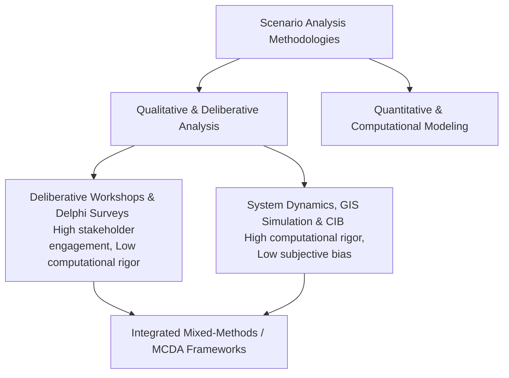

# Methods and Frameworks for Analyzing Scenarios: A Literature Review (2015–2026)

## Executive Summary
This literature review examines peer-reviewed academic literature published from 2015 to 2026 concerning **how to analyze, evaluate, and assess scenarios**. While much futures research focuses on *generating* scenarios, the analytical phase—determining consistency, evaluating performance against multi-criteria objectives, assessing robustness under deep uncertainty, and ranking alternatives—remains a distinct methodological challenge. 

Synthesizing literature across operational research, futures studies, multi-criteria decision analysis (MCDA), and cross-impact methodologies, this review outlines the core quantitative and qualitative techniques used to analyze scenarios, evaluates their strengths and limitations, and identifies persistent research gaps.

---

## 1. Introduction: From Scenario Generation to Scenario Analysis

Scenario planning typically follows a three-stage lifecycle: formulation/generation, analysis/evaluation, and strategic implementation. While early foresight literature emphasized generation (storytelling, drivers of change, axis-method matrices), contemporary scholarly debate underscores that **scenario analysis**—the rigorous evaluation of scenario internal consistency, plausibility, and comparative performance—determines whether scenarios successfully inform policy or remain speculative exercises.

---

## 2. Quantitative vs. Qualitative Analytical Approaches

Analyzing scenarios requires bridging qualitative narratives with quantitative metrics. Methodological literature categorizes analytical approaches into two primary realms:

### A. Qualitative Narrative Analysis
* **Techniques:** Expert elicitation, Delphi surveys, narrative coherence checks, and participatory appraisal.
* **Objective:** Evaluating stakeholder acceptance, social feasibility, and normative desirability.
* **Limitation:** Susceptible to subjective bias, groupthink, and lack of spatial or temporal precision.

### B. Quantitative Simulation & Computational Modeling
* **Techniques:** System dynamics models, cellular automata, GIS-based land-use allocation models, and machine learning forecasters (e.g., ConvLSTM).
* **Objective:** Simulating biophysical, economic, and demographic cascades across space and time.
* **Limitation:** Requires extensive empirical data; risks false precision; opaque "black-box" mechanics reduce transparency for policymakers.

---

## 3. Core Analytical Techniques for Scenarios

Scholarly literature highlights three primary analytical engines used to evaluate and process scenarios:

### A. Cross-Impact Balance (CIB) Analysis
Developed by Weimer-Jehle (2006) and extensively applied in post-2015 energy, political, and environmental studies, CIB is a mathematical method for analyzing impact networks. 
* **Mechanism:** Analysts define key descriptors and alternative states, then populate a matrix evaluating how each state promotes or inhibits others. Algorithms calculate mathematically consistent, stable scenario configurations, filtering out logically contradictory narratives.

### B. Multi-Criteria Decision Analysis (MCDA) & Multi-Actor Multi-Criteria Analysis (MAMCA)
* **Mechanism:** Used to rank alternative scenarios against multiple weighted criteria (e.g., economic cost, carbon reduction, social equity, ecological impact). MAMCA explicitly incorporates multiple stakeholder groups, allowing different actors to weight criteria according to their distinct value systems.

### C. Scenario Robustness Assessment
* **Mechanism:** Stress-testing proposed policies or spatial designs across all generated exploratory scenarios. A robust strategy is defined as one that maintains acceptable performance across the widest range of plausible futures rather than optimizing for a single predicted outcome.

---

## 4. Assessing Plausibility, Consistency, and Validity

A recurring methodological challenge in scenario analysis is establishing quality control. Recent literature (e.g., Airikkala, 2026; Springer scenario assessment frameworks) emphasizes testing scenarios against explicit validity bases:
1. **Internal Consistency:** Ensuring that co-occurring trends within a scenario do not violate physical or economic laws (addressed via CIB or cross-impact matrices).
2. **Empirical Plausibility:** Verifying that baseline assumptions align with historical observations and calibrated simulation models.
3. **Pragmatic Utility:** Evaluating whether the scenario outputs are actionable and interpretable for decision-makers.

---

## 5. Methodological Debates & Challenges

1. **The Quantification-Narrative Trade-off:** A central debate examines whether highly quantified models sacrifice the imaginative richness of qualitative narratives, or whether qualitative storylines lack the analytical rigor required for budget allocation and statutory planning.
2. **Uncertainty Propagation:** As scenarios combine multiple interacting variables, tracking how uncertainty compounds across cascading models remains a major mathematical hurdle.
3. **Transparency vs. Complexity:** Advanced computational scenario analysis tools often suffer from high technical complexity, limiting their accessibility to non-expert stakeholders in participatory governance settings.

---

## 6. Emerging Trends & Future Research Directions

1. **AI-Enhanced Scenario Analytics:** Integrating machine learning algorithms with automated cross-impact analysis to process vast sets of variables and generate real-time scenario evaluations.
2. **Digital Twins and Interactive Scenario Dashboards:** Moving from static reports to dynamic, visual scenario evaluation platforms where stakeholders can test policy interventions in real time.
3. **Consolidated Evaluation Frameworks:** Combining operational research simulation validation with futures evaluation theory to establish standardized benchmarks for scenario quality.

---

## 7. Conclusion

Analyzing scenarios requires a disciplined, multi-method approach that pairs qualitative narrative coherence with quantitative rigor (such as CIB and MCDA). By rigorously evaluating internal consistency, stress-testing policy robustness, and maintaining stakeholder transparency, analysts can transform speculative futures into actionable strategic intelligence.

---
*Literature review completed: November 2026.*
